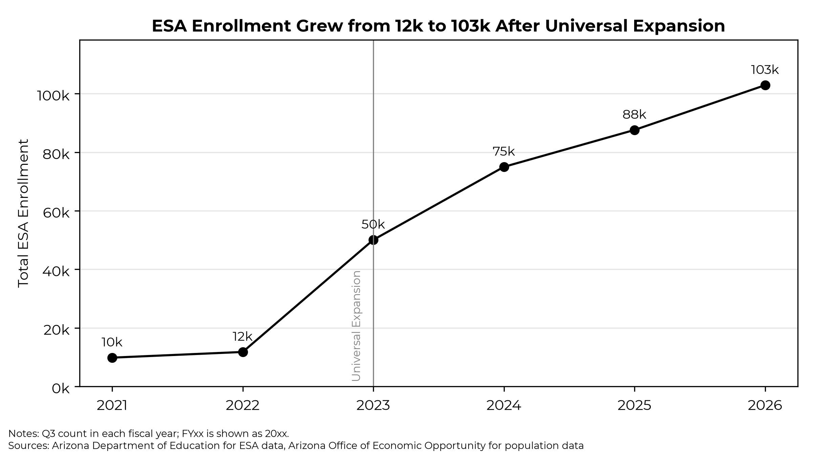
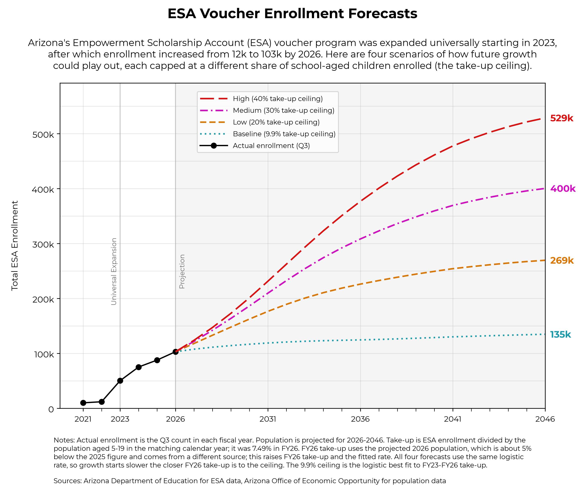
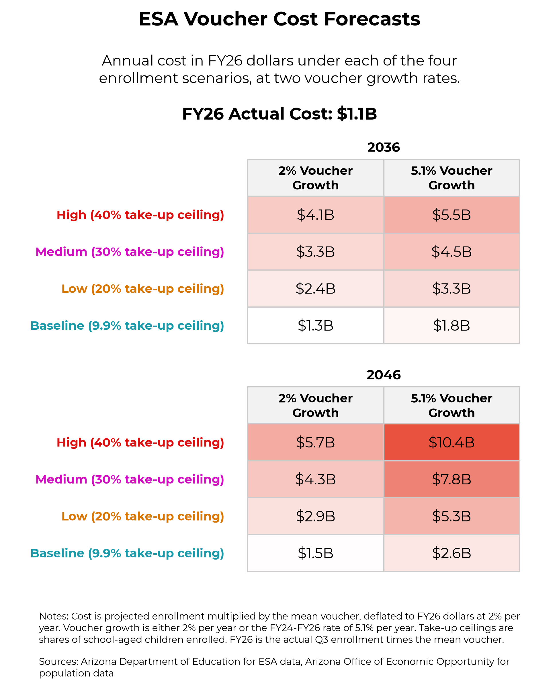

# Forecasting Arizona ESA Enrollment and Program Cost

Tyler Kowch · November 2026

## Executive summary

Arizona's Empowerment Scholarship Account (ESA) program grew from 11,775 students in FY22 to 102,891 in FY26 after eligibility became universal in 2022, with annual costs rising from about $179 million to about $1.1 billion. This report projects enrollment and cost to FY46 using a take-up model with ceilings, applied to the population aged 5–19. If take-up levels off near its current best-fit ceiling (9.9%), enrollment reaches about 135,000 by FY46. If take-up rises to 40%, enrollment reaches about 529,000. In real FY26 dollars, FY46 cost ranges from $1.5 billion to $10.4 billion. The upper half of that range comes from take-up assumptions, not population growth. The program has no statutory enrollment limit, so the state carries an open-ended budget commitment. An enrollment cap, or a funding trigger tied to enrollment, deserves consideration.

## Research question

How will ESA enrollment and program cost change over the next twenty years, and which assumptions drive the range of outcomes?

The question matters because Arizona was the first US state to make all K–12 students eligible for an education savings account, through HB 2853 (2022). Universal eligibility took effect at the beginning of FY23Q1. Enrollment then quadrupled within a year, and it has kept growing at roughly 15–20% a year since. ESA payments come from the state general fund. Unlike public-school formula funding, they do not need a matching decline in district enrolment to be absorbed. Legislators setting multi-year budgets need a defensible range for future cost, not a single extrapolated trend. Because Arizona was first, its path is also a leading indicator for states that have since adopted similar universal programs.

## Data sources

**ESA quarterly reports (FY21Q2–FY26Q4).** The Arizona Department of Education publishes quarterly reports to the legislature. Total enrollment, enrollment by grade, disability category, preschool counts, mean voucher amount and total cost were extracted from 23 PDFs. One observation per year was used: each fiscal year's Q3 report, which avoids seasonal swings in Q4. 

- Note on two types of reports - exec/leg and sbe.
- Reports from FY21Q2 to FY23Q3 use a legacy format with a single disability row.
- FY24 quarters were split across two reports and merged.
- From FY25 the reports stopped stating a mean voucher amount. It was derived as total cost ÷ enrollment.

**Population.** Arizona Office of Economic Opportunity (OEO) estimates for 2023–2025 and Medium Series projections for 2026–2046 supply the population aged 5–19, which serves as the denominator for take-up.

- FY26 uses a projected rather than an estimated population, which introduced a small level shift between sources.

## Analytical approach

**Pipeline.** Python scripts extract each quarterly PDF to CSV, clean and reconcile the fields, and join population by calendar year (FYxx pairs with 20xx). Extraction is covered by unit tests built on text fixtures. Grade-level counts were checked: they sum to total enrollment in every quarter.

**Enrollment.** Enrollment is modelled as take-up × population aged 5–19. Take-up (enrollment ÷ population) was 3.5% in FY23 and 7.5% in FY26. Take-up is projected along a logistic path:

> takeup(t) = K / (1 + (K / y₀ − 1)·e^(−r·t))

Here y₀ is FY26 take-up, K is a ceiling, and r is the growth rate of log take-up estimated over FY23–FY26 (r = 0.246). The logistic form fits a program that saturates: growth is fast when few eligible families participate and slows as the remaining families are less likely to switch. Because the data cannot identify a ceiling, four are used as scenarios:
- **9.9%**: logistic best fit to FY23–FY26 (standard error ±3.5 percentage points) (FLAG)
- **20%, 30% and 40%**: progressively larger shifts away from district and charter schools

**Cost.** Cost = enrollment × mean voucher. The mean voucher grows from the FY26 actual ($10,838) under two scenarios: 2% inflation, or the FY24–FY26 historical rate (about 5.1% a year). Costs are reported in real FY26 dollars (deflated at 2% a year).

**Why this design.** With little post-expansion data points, any statistical forecast would produce intervals too wide to use. Scenario ceilings make the main uncertainty explicit, rather than hiding it in a single fitted parameter.

## Principal findings

### Enrollment

All scenarios start from 102,891 students in FY26. Under the best-fit ceiling, growth slows quickly: about 124,000 by FY36 and 135,000 by FY46. Higher ceilings keep growth going much longer. FY46 enrollment reaches 269,000 (20%), 400,000 (30%) and 529,000 (40%). Population aged 5–19 is projected to be roughly flat over the period (1.29–1.37 million), so almost all of the variation across scenarios comes from take-up.

### Program cost scenarios

Across the eight combinations, FY46 real cost runs from $1.5 billion to $10.4 billion (nominal: $2.2–15.4 billion). Within ten years (FY36), the range is already $1.3–5.5 billion. The take-up ceiling accounts for more of the spread than voucher growth does. At FY46 with 2% vouchers, moving from the 9.9% to the 40% ceiling multiplies cost by 3.9. Switching voucher growth from 2% to the historical rate multiplies it by about 1.8.

## Limitations

- **Short series.** Only four annual post-expansion observations exist. The growth rate r and the best-fit ceiling are weakly identified.
- **Structural break.** Pre-2023 data describe a targeted program and cannot be used to estimate universal take-up.
- **Population sources.** Estimates and projections come from different OEO series, and the projections are themselves uncertain.
- **No behavioural feedback.** The model ignores tuition responses by private schools, changes in policy and the capacity of the private sector.
- **Extraction.** Report formats changed several times. Automated extraction was tested but may still contain errors.

## Policy implications

Even the most conservative scenario adds about $350 million in real annual cost by FY46. Plausible higher-take-up paths add several billion dollars. Because the program is uncapped and entitlement-like, appropriations follow demand. The fiscal risk is therefore asymmetric: costs can only be controlled after the fact.

Three responses follow. First, the state could introduce an enrollment cap or a funding trigger, which would turn an open-ended liability into a budgeted one. Second, the state could index award growth explicitly, since voucher growth roughly doubles cost under every take-up path. Third, the state could continue quarterly monitoring and compare actual take-up with the scenario ceilings, so that the budget can move to the relevant path early. (FLAG - UPDATE)

## Conclusion

ESA cost is set mainly by how far take-up eventually rises, which current data cannot pin down. Projected FY46 cost ranges from $1.5 billion to $10.4 billion in real terms. Policymakers should budget for that range and consider a structural limit rather than rely on a single forecast.

---

## References

- Arizona Department of Education, ESA quarterly reports to the legislature, FY21Q2–FY26Q4. TODO: add URL.
- Arizona Office of Economic Opportunity, population estimates and 2025–2060 projections (Medium Series). https://oeo.az.gov/population/projections
- Arizona Legislature, HB 2853 (2022), universal ESA eligibility. TODO: add URL.

## AI use statement

TODO: Describe how AI tools were used (e.g., Claude Code for extraction code, plots and drafting this report; all figures checked against `outputs/report/forecast.csv`).
