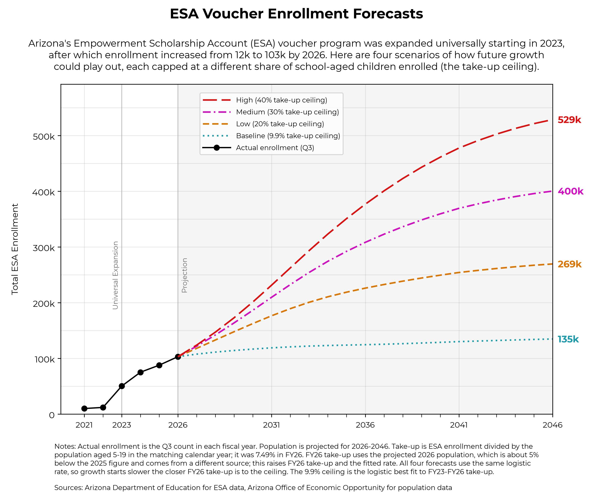

# Forecasting Arizona ESA Enrollment and Program Cost

Tyler Kowch · TODO date

<!-- Total target: ~1,500 words (excludes references and AI use statement). -->

## Executive summary
<!-- target: 120 words -->

- TODO: Headline enrollment forecast (end of horizon, from `outputs/report/forecast.csv`).
- TODO: Headline cost forecast and scenario range.
- TODO: One-sentence policy takeaway. - Implications for budgeting in Arizona, suggested need for a cap on enrollment.

## Research question
<!-- target: 150 words -->

TODO: State the question: how will Arizona Empowerment Scholarship Account (ESA) enrollment and program cost evolve over the forecast horizon?

TODO: Why it matters: 2022 universal eligibility expansion, budget pressure, comparability to other states (first in the nation).

## Data sources
<!-- target: 200 words -->

TODO: Quarterly ESA reports, FY21Q2–FY26Q4 (`data/raw/voucher_reports/`): enrollment, disability categories, mean voucher.

TODO: Arizona population actuals and projections (school-age denominator).

TODO: Caveats:
- FY21Q2–FY23Q3 legacy format: a single disability row covers all students.
- FY24 quarters split across SBE and non-SBE reports, merged per quarter.
- Mean voucher drawn from narrative, table, or appendix fallback.
- Missing values left blank; no imputation.

## Analytical approach
<!-- target: 300 words -->

TODO: Pipeline: PDF extraction → cleaning → population merge (`src/voucher_growth_model/data_cleaning/`).

TODO: Forecast model specification and justification (`src/voucher_growth_model/forecast.py`).

TODO: Cost projection: enrollment × mean voucher; scenario assumptions.

TODO: Validation/back-testing, if any. Key choices logged in `docs/decisions.md`.

## Principal findings
<!-- target: 350 words -->

### Enrollment

TODO: Trend, growth rate, forecast level and interval.

### Program cost

TODO: Cost trajectory and drivers (enrollment vs. per-student amount).

### Cost scenarios

TODO: Range across scenarios and what separates them.

### Summary table

## Limitations
<!-- target: 180 words -->

- TODO: Short series; few post-expansion quarters.
- TODO: Structural break at universal expansion (2022).
- TODO: Extraction risk from changing report formats.
- TODO: Scenario assumptions; no behavioural/policy feedback.

## Policy implications
<!-- target: 150 words -->

TODO: Budget planning, appropriation risk, monitoring recommendations.

## Conclusion
<!-- target: 50 words -->

TODO

---

## References
<!-- Not counted. -->

- TODO: Arizona Department of Education ESA quarterly reports.
- TODO: Population data source(s) - Arizona Department of Econonomic Oppurtunity.

## AI use statement
<!-- Not counted. -->

TODO: Describe how AI tools were used.

## Appendix (optional)
- `outputs/draft/forecast/forecast_slide_draft.png`
- `outputs/report/forecast_slide_report.png`
